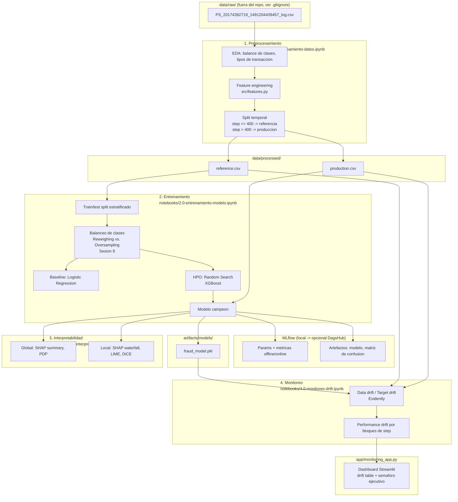

# Proyecto_ML_Engineering_DSRP_III_2026_Fraud_Detection

> Proyecto final — **Machine Learning Engineering III**, DataScienceResearchPeru
> (cohorte 2026). Deteccion de fraude en transacciones de dinero movil
> (dataset simulado **PaySim**).

> **Estado del proyecto:** scaffolding completo (notebooks, src, app,
> documentacion). Pendiente ejecutar el pipeline con el dataset real
> (`PS_20174392719_1491204439457_log.csv`) para poblar metricas, graficos
> de interpretabilidad y reportes de drift reales. Ver seccion
> [Como reproducir](#como-reproducir).

---

## Tabla de contenido

1. [Problema de ML](#a-problema-de-ml)
2. [Diagrama de flujo del proyecto](#b-diagrama-de-flujo-del-proyecto)
3. [Dataset y diccionario de datos](#c-dataset-y-diccionario-de-datos)
4. [Tecnicas de optimizacion de hiperparametros](#d-tecnicas-de-optimizacion-de-hiperparametros)
5. [Model Card](#e-model-card)
6. [Resultados — metricas offline y online](#f-resultados--metricas-offline-y-online)
7. [Interpretabilidad del modelo](#g-interpretabilidad-del-modelo)
8. [Conclusiones](#h-conclusiones)
9. [MLflow — experimentos](#i-mlflow--experimentos)
10. [Monitoreo y app de drift](#j-monitoreo-y-app-de-drift)
11. [Estructura del repositorio](#k-estructura-del-repositorio)
12. [Estrategia de Git](#l-estrategia-de-git)
13. [Como reproducir](#como-reproducir)

---

## a. Problema de ML

**Tipo de problema:** aprendizaje **supervisado**, subtipo **clasificacion
binaria**.

**Target:** `isFraud` — si una transaccion de dinero movil es fraudulenta
(1) o legitima (0).

**Contexto de negocio:** en la simulacion PaySim, un agente fraudulento
toma el control de una cuenta, transfiere (`TRANSFER`) el dinero a otra
cuenta y luego lo retira (`CASH_OUT`) antes de que el sistema reaccione.
El objetivo es **priorizar transacciones sospechosas** para revision,
maximizando la deteccion de fraude (`recall`) sin generar tantos falsos
positivos que el equipo de riesgo no pueda operar (`precision`).

**Reto principal:** desbalance extremo de clases (~0.1-0.3% de
transacciones son fraude) — ver seccion de optimizacion y metricas.

## b. Diagrama de flujo del proyecto



## c. Dataset y diccionario de datos

Dataset **PaySim** — ver diccionario completo y features derivadas en
[`data/README.md`](data/README.md). Resumen:

- ~6.3M transacciones, 744 `step` (30 dias simulados), 5 tipos de
  transaccion (`CASH-IN`, `CASH-OUT`, `DEBIT`, `PAYMENT`, `TRANSFER`).
- Target `isFraud` extremadamente desbalanceado (~0.1-0.3%).
- Split obligatorio del proyecto: `step <= 400` → referencia/entrenamiento;
  `step > 400` → produccion (evaluacion online + monitoreo).

## d. Tecnicas de optimizacion de hiperparametros

Implementadas y comparadas en
[`notebooks/2.0-entrenamiento-modelo.ipynb`](notebooks/2.0-entrenamiento-modelo.ipynb):

| Tecnica | Rol |
|---|---|
| **Random Search** (`RandomizedSearchCV`, Sesion 3) | Busqueda de hiperparametros para `XGBClassifier`; los mejores parametros encontrados entrenan el modelo campeon. |
| `StratifiedKFold` (CV) | Validacion cruzada estratificada durante la optimizacion, para no sesgar por el desbalance. |

### Balanceo de clases (Sesion 8)

El target (`isFraud`) esta fuertemente desbalanceado (~0.1-0.3% positivos).
En vez de usar atajos no vistos en el curso (`scale_pos_weight`,
`class_weight="balanced"`) o librerias externas (`imbalanced-learn`/SMOTE),
se generalizan las dos tecnicas de la Sesion 8 (`mod0_Reweighing.ipynb`,
`mod1_Oversampling.ipynb`) — pensadas ahi para equilibrar un grupo
sensible — al desbalance de la clase objetivo (ver
[`src/balancing.py`](src/balancing.py)):

| Tecnica | Mecanica (igual que en el curso) |
|---|---|
| **Reweighing** | Pesos pasados como `sample_weight` a `.fit()`, inversamente proporcionales a la frecuencia de cada clase. |
| **Oversampling** | Duplicar con reemplazo la clase minoritaria via `sklearn.utils.resample`. |

Ambas se comparan en el notebook (seccion 2.1) con un holdout simple y
`RandomForestClassifier` — igual que en la Sesion 8 — y se elige la de
mejor PR-AUC para usarse en el resto del entrenamiento (baseline + HPO).

## e. Model Card

Ver [`model_card/model_card.md`](model_card/model_card.md) (uso previsto,
limitaciones, consideraciones eticas).

## f. Resultados — metricas offline y online

> ⏳ *Pendiente de poblar tras ejecutar
> `notebooks/2.0-entrenamiento-modelo.ipynb` con el dataset real.*

| Metrica | Offline (holdout, step ≤ 400) | Online (produccion, step > 400) |
|---|---|---|
| Accuracy | — | — |
| Precision | — | — |
| Recall | — | — |
| F1 | — | — |
| ROC-AUC | — | — |
| PR-AUC | — | — |
| Log loss | — | — |

Metrica principal recomendada: **PR-AUC** (mas informativa que ROC-AUC o
accuracy bajo clases tan desbalanceadas).

## g. Interpretabilidad del modelo

Implementada en
[`notebooks/3.0-interpretabilidad.ipynb`](notebooks/3.0-interpretabilidad.ipynb):

- **Global**: SHAP summary plot (bar + beeswarm), Partial Dependence Plots
  de las features mas importantes.
- **Local**: SHAP waterfall para un verdadero positivo y un falso
  positivo, explicacion LIME de contraste, y un **contrafactual
  accionable** con DiCE (cambio minimo para pasar de "fraude" a
  "legitimo").

> ⏳ *Hallazgos (features dominantes, consistencia SHAP/LIME) se
> documentaran aqui tras correr el notebook con datos reales.*

## h. Conclusiones

> ⏳ *Pendiente — completar tras entrenamiento, interpretabilidad y
> monitoreo con el dataset real. Debe cubrir: desempeno alcanzado vs.
> baseline, principales drivers del modelo, estabilidad en produccion
> (drift) y recomendacion de estrategia de mantenimiento (retraining /
> champion-challenger, Sesion 10).*

## i. MLflow — experimentos

Tracking **local** por defecto (SQLite: el backend de archivos plano
`./mlruns` quedo en modo mantenimiento desde MLflow 3.x):

```bash
mlflow ui --backend-store-uri sqlite:///mlflow.db
```

El codigo (`src/tracking.py`) lee `MLFLOW_TRACKING_URI` desde el entorno,
por lo que apuntar a un backend remoto (p.ej. **DagsHub**) para publicar
los experimentos solo requiere exportar variables de entorno, sin tocar
el codigo:

```bash
export MLFLOW_TRACKING_URI=https://dagshub.com/<usuario>/<repo>.mlflow
export MLFLOW_TRACKING_USERNAME=<usuario>
export MLFLOW_TRACKING_PASSWORD=<token>
```

> ⏳ *Link publico a DagsHub pendiente (actualmente corriendo tracking
> local mientras se valida el pipeline).*

## j. Monitoreo y app de drift

- Notebook: [`notebooks/4.0-monitoreo-drift.ipynb`](notebooks/4.0-monitoreo-drift.ipynb)
  — genera reportes HTML de Evidently (`app/reports/`) con data drift,
  target drift y desempeno del modelo; ademas calcula la degradacion de
  metricas por bloques de `step` en produccion.
- App: [`app/monitoring_app.py`](app/monitoring_app.py) — dashboard
  Streamlit inspirado en el
  [tutorial de Evidently AI](https://www.evidentlyai.com/blog/ml-model-monitoring-dashboard-tutorial),
  con tabla de drift por feature (tipo, drift score, test estadistico,
  flag de deteccion), filtro por ventana de `step` y un **semaforo
  ejecutivo** (🟢/🟡/🔴) con el % de features con drift.

```bash
streamlit run app/monitoring_app.py
```

## k. Estructura del repositorio

```
.
├── README.md
├── LICENSE
├── requirements.txt
├── .gitignore
├── notebooks/
│   ├── 1.0-preprocesamiento-datos.ipynb
│   ├── 2.0-entrenamiento-modelo.ipynb
│   ├── 3.0-interpretabilidad.ipynb
│   └── 4.0-monitoreo-drift.ipynb
├── data/
│   ├── README.md            # diccionario de datos
│   ├── raw/                 # dataset crudo (gitignored)
│   └── processed/           # reference.csv, production.csv (.csv versionados si el tamano lo permite)
├── app/
│   ├── monitoring_app.py    # dashboard Streamlit de monitoreo
│   └── reports/             # reportes HTML de Evidently
├── src/                     # codigo reutilizable (config, features, metricas, mlflow)
├── artifacts/models/        # modelo entrenado serializado
├── model_card/model_card.md
├── reports/                 # figuras (SHAP, matriz de confusion, etc.)
└── mlflow.db                # tracking local de MLflow, SQLite (gitignored)
```

## l. Estrategia de Git

Se sigue **[GitHub Flow](https://docs.github.com/es/get-started/using-github/github-flow)**
simplificado a dos ramas largas (para alinear con el requisito del
proyecto de tener `main` y `development`):

- **`main`**: siempre desplegable / version estable. Solo recibe merges
  desde `development` al cerrar un hito (p.ej. un release).
- **`development`**: rama de integracion. Las features se desarrollan en
  ramas `feature/<nombre>` y se integran via **Pull Request** hacia
  `development` (revision + merge, nunca push directo a `main`).
- **Releases**: se etiquetan en `main` siguiendo
  [SemVer](https://semver.org/lang/es/) (`v1.0.0` para la entrega final del
  curso III), con notas de release en GitHub.

Flujo tipico:

```
feature/xxx  --PR-->  development  --PR/merge-->  main  --tag-->  vX.Y.Z
```

## Como reproducir

```bash
# 1. Clonar y crear entorno
git clone https://github.com/macho9099/Proyecto_ML_Engineering_DSRP_III_2026_Fraud_Detection.git
cd Proyecto_ML_Engineering_DSRP_III_2026_Fraud_Detection
python -m venv .venv && source .venv/bin/activate   # Windows: .venv\Scripts\activate
pip install -r requirements.txt

# 2. Descargar el dataset PaySim desde Kaggle (https://www.kaggle.com/datasets/ealaxi/paysim1)
#    y colocarlo en:
mkdir -p data/raw
# data/raw/PS_20174392719_1491204439457_log.csv

# 3. (Opcional) Apuntar a una ruta distinta del CSV
export RAW_DATA_PATH=/ruta/a/tu/archivo.csv   # Windows: set RAW_DATA_PATH=...

# 4. Ejecutar los notebooks en orden
jupyter lab notebooks/

# 5. Ver experimentos de MLflow
mlflow ui --backend-store-uri sqlite:///mlflow.db

# 6. Levantar la app de monitoreo
streamlit run app/monitoring_app.py
```
