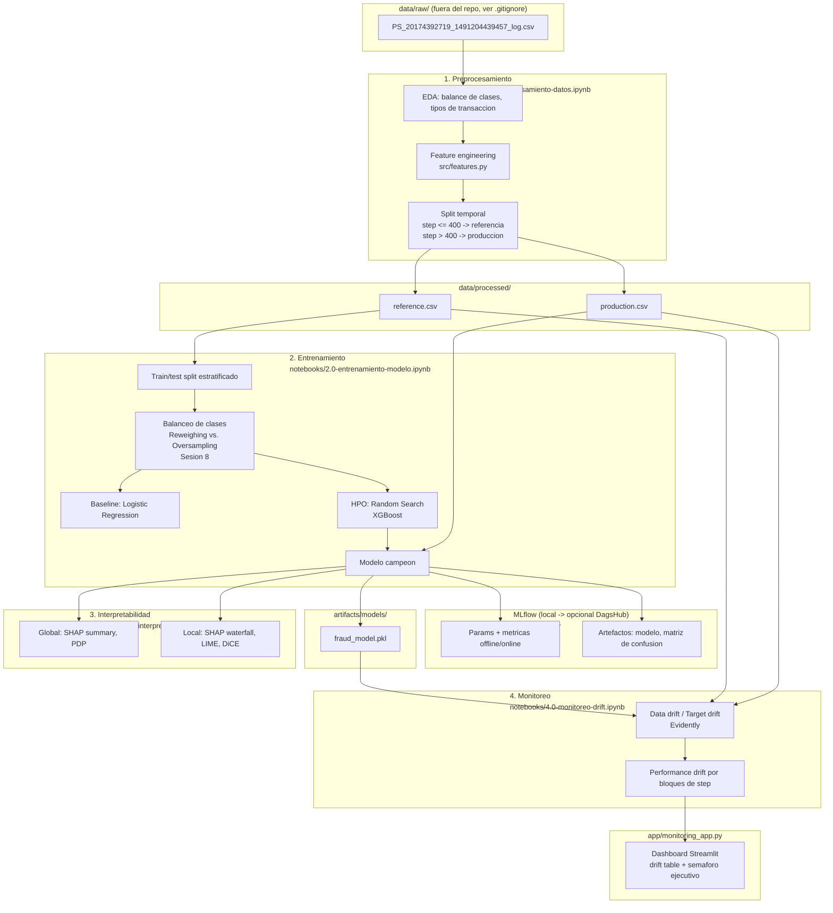

# Proyecto_ML_Engineering_DSRP_III_2026_Fraud_Detection

> Proyecto final — **Machine Learning Engineering III**, DataScienceResearchPeru
> (cohorte 2026). Deteccion de fraude en transacciones de dinero movil
> (dataset simulado **PaySim**).

> **Estado del proyecto:** pipeline completo ejecutado de inicio a fin
> sobre el dataset real de PaySim (notebooks 1-4). Resultados, hallazgos
> de interpretabilidad y reportes de drift son reales (seccion
> [f](#f-resultados--metricas-offline-y-online) en adelante). Por
> limitaciones de computo del equipo de desarrollo, el entrenamiento usa
> una submuestra representativa de la referencia (ver nota en la
> seccion f) — la evaluacion online usa el 100% de produccion, sin
> submuestrear.

---

## Tabla de contenido

1. [Problema de ML](#a-problema-de-ml)
2. [Diagrama de flujo del proyecto](#b-diagrama-de-flujo-del-proyecto)
3. [Dataset y diccionario de datos](#c-dataset-y-diccionario-de-datos)
4. [Tecnicas de optimizacion de hiperparametros](#d-tecnicas-de-optimizacion-de-hiperparametros)
5. [Model Card](#e-model-card)
6. [Resultados — metricas offline y online](#f-resultados--metricas-offline-y-online)
7. [Interpretabilidad del modelo](#g-interpretabilidad-del-modelo)
8. [Conclusiones](#h-conclusiones)
9. [MLflow — experimentos](#i-mlflow--experimentos)
10. [Monitoreo y app de drift](#j-monitoreo-y-app-de-drift)
11. [Estructura del repositorio](#k-estructura-del-repositorio)
12. [Estrategia de Git](#l-estrategia-de-git)
13. [Como reproducir](#como-reproducir)

---

## a. Problema de ML

**Tipo de problema:** aprendizaje **supervisado**, subtipo **clasificacion
binaria**.

**Target:** `isFraud` — si una transaccion de dinero movil es fraudulenta
(1) o legitima (0).

**Contexto de negocio:** en la simulacion PaySim, un agente fraudulento
toma el control de una cuenta, transfiere (`TRANSFER`) el dinero a otra
cuenta y luego lo retira (`CASH_OUT`) antes de que el sistema reaccione.
El objetivo es **priorizar transacciones sospechosas** para revision,
maximizando la deteccion de fraude (`recall`) sin generar tantos falsos
positivos que el equipo de riesgo no pueda operar (`precision`).

**Reto principal:** desbalance extremo de clases (~0.1-0.3% de
transacciones son fraude) — ver seccion de optimizacion y metricas.

## b. Diagrama de flujo del proyecto



## c. Dataset y diccionario de datos

Dataset **PaySim** — ver diccionario completo y features derivadas en
[`data/README.md`](data/README.md). Resumen:

- ~6.3M transacciones, 744 `step` (30 dias simulados), 5 tipos de
  transaccion (`CASH-IN`, `CASH-OUT`, `DEBIT`, `PAYMENT`, `TRANSFER`).
- Target `isFraud` extremadamente desbalanceado (~0.1-0.3%).
- Split obligatorio del proyecto: `step <= 400` → referencia/entrenamiento;
  `step > 400` → produccion (evaluacion online + monitoreo).

## d. Tecnicas de optimizacion de hiperparametros

Implementadas y comparadas en
[`notebooks/2.0-entrenamiento-modelo.ipynb`](notebooks/2.0-entrenamiento-modelo.ipynb):

| Tecnica | Rol |
|---|---|
| **Random Search** (`RandomizedSearchCV`, Sesion 3) | Busqueda de hiperparametros para `XGBClassifier`; los mejores parametros encontrados entrenan el modelo campeon. |
| `StratifiedKFold` (CV) | Validacion cruzada estratificada durante la optimizacion, para no sesgar por el desbalance. |

### Balanceo de clases (Sesion 8)

El target (`isFraud`) esta fuertemente desbalanceado (~0.1-0.3% positivos).
En vez de usar atajos no vistos en el curso (`scale_pos_weight`,
`class_weight="balanced"`) o librerias externas (`imbalanced-learn`/SMOTE),
se generalizan las dos tecnicas de la Sesion 8 (`mod0_Reweighing.ipynb`,
`mod1_Oversampling.ipynb`) — pensadas ahi para equilibrar un grupo
sensible — al desbalance de la clase objetivo (ver
[`src/balancing.py`](src/balancing.py)):

| Tecnica | Mecanica (igual que en el curso) |
|---|---|
| **Reweighing** | Pesos pasados como `sample_weight` a `.fit()`, inversamente proporcionales a la frecuencia de cada clase. |
| **Oversampling** | Duplicar con reemplazo la clase minoritaria via `sklearn.utils.resample`. |

Ambas se comparan en el notebook (seccion 2.1) con `RandomForestClassifier`
(igual que en la Sesion 8) sobre **5-fold `StratifiedKFold`**, aplicando el
balanceo *dentro* de cada fold de entrenamiento — nunca antes del split —
para no filtrar informacion entre train y validacion (critico para
oversampling: sobremuestrear antes de dividir en folds dejaria copias casi
identicas de una misma fila repartidas entre train y validacion). Se elige
la estrategia con mejor PR-AUC promedio para usarse en el resto del
entrenamiento (baseline + HPO).

## e. Model Card

Ver [`model_card/model_card.md`](model_card/model_card.md) (uso previsto,
limitaciones, consideraciones eticas).

## f. Resultados — metricas offline y online

> **Nota de computo:** la referencia completa (`step <= 400`) tiene
> ~5.79M filas. En el equipo de desarrollo de este proyecto (CPU movil
> de 8 cores, ~14 GB RAM) una sola comparacion de balanceo con 5-fold CV
> sobre ese volumen no termino tras mas de una hora (probable *memory
> thrashing*). Se opto por una **submuestra estratificada de 1.8M filas**
> de referencia (31% del total, misma tasa real de fraude via
> `stratify`), y se recorto moderadamente el espacio de busqueda de
> Random Search (`n_iter=10`, `n_estimators <= 400`) y el balanceo
> (`StratifiedKFold` de 3 en vez de 5, 100 arboles en vez de 200 para esa
> comparacion puntual). La **evaluacion online usa el 100% de produccion**
> (575,590 filas), sin submuestrear. Detalle en
> `notebooks/2.0-entrenamiento-modelo.ipynb` (celda de carga de datos).

**Balanceo de clases** (comparacion 3-fold CV, tasa de fraude real ≈0.077%):

| Estrategia | Precision | Recall | F1 | PR-AUC | ROC-AUC |
|---|---|---|---|---|---|
| Original (sin balanceo) | 1.000 | 0.9946 | 0.9973 | 0.9961 | 0.9982 |
| **Reweighing (elegida)** | 0.9844 | 0.9946 | 0.9894 | **0.9963** | 0.9989 |
| Oversampling | 0.9947 | 0.9946 | 0.9946 | 0.9962 | 0.9988 |

**Hiperparametros** elegidos por Random Search (XGBoost): `n_estimators=200`,
`max_depth=3`, `learning_rate=0.05`, `subsample=0.6`, `colsample_bytree=0.8`,
`min_child_weight=3`.

**Modelo campeon (XGBoost) vs. baseline (Logistic Regression + Reweighing):**

| Metrica | Baseline (offline) | XGBoost Offline (holdout, step ≤ 400) | XGBoost Online (produccion, step > 400) |
|---|---|---|---|
| Accuracy | 0.3397 | 0.99994 | 0.99996 |
| Precision | 0.0012 | 0.9354 | 0.9987 |
| Recall | 0.9892 | 0.9857 | 0.9949 |
| F1 | 0.0023 | 0.9599 | 0.9968 |
| ROC-AUC | 0.7638 | 0.9961 | 0.99997 |
| PR-AUC | 0.0301 | 0.9857 | 0.9990 |
| Log loss | 0.5575 | 0.00048 | 0.00039 |

El baseline (regresion logistica + reweighing) logra recall alto pero
precision inutilizable (~0.1%) — confirma que, bajo un desbalance tan
extremo, un modelo lineal simple no alcanza; XGBoost + HPO + balanceo
es lo que hace viable el caso de uso. **PR-AUC** es la metrica principal
(mas informativa que accuracy/ROC-AUC bajo clases tan desbalanceadas); el
desempeno **mejora** de offline a online (0.986 → 0.999 PR-AUC), pese a
que produccion tiene una tasa de fraude ~8x mayor que referencia (ver
seccion j) — el patron de fraude en si no cambio, solo su frecuencia.

## g. Interpretabilidad del modelo

Implementada en
[`notebooks/3.0-interpretabilidad.ipynb`](notebooks/3.0-interpretabilidad.ipynb):

- **Global**: SHAP summary plot (bar + beeswarm), Partial Dependence Plots
  de las features mas importantes.
- **Local**: SHAP waterfall para un verdadero positivo y un falso
  positivo, explicacion LIME de contraste, y un **contrafactual
  accionable** con DiCE (cambio minimo para pasar de "fraude" a
  "legitimo").

**Hallazgos (sobre una muestra de 20k filas de referencia):**

- **Features dominantes (SHAP global)**: `errorBalanceOrig`,
  `amountToOldBalanceOrgRatio` y `newbalanceOrig` — consistente con la
  intuicion de negocio del Anexo 1 (inconsistencias de saldo y vaciado de
  cuenta son la senal mas fuerte de fraude).
- **Consistencia SHAP/LIME**: en el caso local analizado (verdadero
  positivo), LIME coincide en que `amountToOldBalanceOrgRatio`,
  `oldbalanceDest`/`newbalanceDest` altos y el tipo de transaccion son los
  factores que mas empujan la prediccion hacia "fraude" — mismo grupo de
  features que destaca SHAP a nivel global.
- **Contrafactual (DiCE)**: para una transaccion `CASH_OUT` marcada como
  fraude, el cambio minimo que la voltea a "legitima" es alterar
  sustancialmente `errorBalanceOrig` (la inconsistencia de saldo) y, en
  dos de tres contrafactuales, cambiar el tipo de transaccion a
  `CASH_IN`/`TRANSFER` — refuerza que el modelo aprendio precisamente el
  patron descrito en el Anexo 1 (toma de cuenta + vaciado via
  `TRANSFER`/`CASH_OUT`), no una correlacion espuria.

## h. Conclusiones

- **Desempeno**: el modelo campeon (XGBoost + Random Search + Reweighing)
  alcanza PR-AUC 0.986 offline y 0.999 online, muy por encima del baseline
  lineal (PR-AUC 0.030) — confirma que, con un desbalance tan extremo
  (~0.08% de fraude), hace falta un modelo no lineal bien afinado, no solo
  balanceo de clases.
- **Drivers del modelo**: consistentes con el negocio — inconsistencias de
  saldo (`errorBalanceOrig`) y vaciado de cuenta
  (`amountToOldBalanceOrgRatio`) dominan tanto a nivel global (SHAP) como
  local (LIME, contrafactuales DiCE), y el contrafactual confirma que el
  modelo aprendio el patron real de fraude del Anexo 1 (toma de cuenta +
  `TRANSFER`/`CASH_OUT`), no una correlacion espuria.
- **Estabilidad en produccion**: **no hay data drift** detectado en las 16
  features de entrada (0/16 con Evidently `DataDriftPreset`) — pero **si
  hay un target drift fuerte**: la tasa de fraude pasa de 0.077%
  (referencia) a 0.649% (produccion), ~8.4x mas alta. Pese a eso, el
  desempeno del modelo se mantiene estable y alto en los 10 bloques de
  tiempo de produccion (PR-AUC entre 0.997 y 1.000, sin tendencia a la
  baja) — el modelo generaliza bien porque el *patron* de fraude no
  cambio, solo su frecuencia.
- **Recomendacion de mantenimiento** (Sesion 10): dado que no hay
  degradacion de desempeno pero si un cambio marcado en la tasa base de
  fraude, la estrategia recomendada por ahora es **monitoreo activo del
  target drift** (alertar si la tasa de fraude o el PR-AUC por bloque de
  tiempo se desvian de los rangos observados) en vez de retraining
  inmediato; un **esquema Champion-Challenger** seria el siguiente paso
  natural si llegara a detectarse degradacion real de PR-AUC/recall.

## i. MLflow — experimentos

Tracking **local** por defecto (SQLite: el backend de archivos plano
`./mlruns` quedo en modo mantenimiento desde MLflow 3.x):

```bash
mlflow ui --backend-store-uri sqlite:///mlflow.db
```

El codigo (`src/tracking.py`) lee `MLFLOW_TRACKING_URI` desde el entorno,
por lo que apuntar a un backend remoto (p.ej. **DagsHub**) para publicar
los experimentos solo requiere exportar variables de entorno, sin tocar
el codigo:

```bash
export MLFLOW_TRACKING_URI=https://dagshub.com/<usuario>/<repo>.mlflow
export MLFLOW_TRACKING_USERNAME=<usuario>
export MLFLOW_TRACKING_PASSWORD=<token>
```

> ⏳ *Link publico a DagsHub pendiente — por ahora el tracking corre
> local (`mlflow.db`, no versionado en git). Los experimentos reales del
> pipeline completo (comparacion de balanceo, baseline, Random Search,
> modelo campeon con metricas offline/online) quedan registrados ahi;
> correr `mlflow ui --backend-store-uri sqlite:///mlflow.db` para
> inspeccionarlos.*

## j. Monitoreo y app de drift

- Notebook: [`notebooks/4.0-monitoreo-drift.ipynb`](notebooks/4.0-monitoreo-drift.ipynb)
  — genera reportes HTML de Evidently (`app/reports/`) con data drift,
  target drift y desempeno del modelo; ademas calcula la degradacion de
  metricas por bloques de `step` en produccion.
- App: [`app/monitoring_app.py`](app/monitoring_app.py) — dashboard
  Streamlit inspirado en el
  [tutorial de Evidently AI](https://www.evidentlyai.com/blog/ml-model-monitoring-dashboard-tutorial),
  con tabla de drift por feature (tipo, drift score, test estadistico,
  flag de deteccion), filtro por ventana de `step` y un **semaforo
  ejecutivo** (🟢/🟡/🔴) con el % de features con drift.

**Resultados reales** (referencia 1.8M filas vs. produccion completa,
575,590 filas):

| Chequeo | Resultado |
|---|---|
| Data drift (16 features) | 🟢 **0/16** features con drift (`dataset_drift=False`) |
| Target drift | 🔴 Tasa de fraude 0.077% → 0.649% (**~8.4x**) |
| Performance drift (10 bloques de `step` en produccion) | 🟢 PR-AUC estable entre 0.997-1.000, sin tendencia a la baja |

Ver detalle y graficos en
[`notebooks/4.0-monitoreo-drift.ipynb`](notebooks/4.0-monitoreo-drift.ipynb)
y los reportes HTML en `app/reports/` (generados localmente, no
versionados por tamano — correr el notebook para regenerarlos).

```bash
streamlit run app/monitoring_app.py
```

## k. Estructura del repositorio

```
.
├── README.md
├── LICENSE
├── requirements.txt
├── .gitignore
├── notebooks/
│   ├── 1.0-preprocesamiento-datos.ipynb
│   ├── 2.0-entrenamiento-modelo.ipynb
│   ├── 3.0-interpretabilidad.ipynb
│   └── 4.0-monitoreo-drift.ipynb
├── data/
│   ├── README.md            # diccionario de datos
│   ├── raw/                 # dataset crudo (gitignored)
│   └── processed/           # reference.csv, production.csv (.csv versionados si el tamano lo permite)
├── app/
│   ├── monitoring_app.py    # dashboard Streamlit de monitoreo
│   └── reports/             # reportes HTML de Evidently
├── src/                     # codigo reutilizable (config, features, metricas, mlflow)
├── artifacts/models/        # modelo entrenado serializado
├── model_card/model_card.md
├── reports/                 # figuras (SHAP, matriz de confusion, etc.)
└── mlflow.db                # tracking local de MLflow, SQLite (gitignored)
```

## l. Estrategia de Git

Se sigue **[GitHub Flow](https://docs.github.com/es/get-started/using-github/github-flow)**
simplificado a dos ramas largas (para alinear con el requisito del
proyecto de tener `main` y `development`):

- **`main`**: siempre desplegable / version estable. Solo recibe merges
  desde `development` al cerrar un hito (p.ej. un release).
- **`development`**: rama de integracion. Las features se desarrollan en
  ramas `feature/<nombre>` y se integran via **Pull Request** hacia
  `development` (revision + merge, nunca push directo a `main`).
- **Releases**: se etiquetan en `main` siguiendo
  [SemVer](https://semver.org/lang/es/) (`v1.0.0` para la entrega final del
  curso III), con notas de release en GitHub.

Flujo tipico:

```
feature/xxx  --PR-->  development  --PR/merge-->  main  --tag-->  vX.Y.Z
```

## Como reproducir

```bash
# 1. Clonar y crear entorno
git clone https://github.com/macho9099/Proyecto_ML_Engineering_DSRP_III_2026_Fraud_Detection.git
cd Proyecto_ML_Engineering_DSRP_III_2026_Fraud_Detection
python -m venv .venv && source .venv/bin/activate   # Windows: .venv\Scripts\activate
pip install -r requirements.txt

# 2. Descargar el dataset PaySim desde Kaggle (https://www.kaggle.com/datasets/ealaxi/paysim1)
#    y colocarlo en:
mkdir -p data/raw
# data/raw/PS_20174392719_1491204439457_log.csv

# 3. (Opcional) Apuntar a una ruta distinta del CSV
export RAW_DATA_PATH=/ruta/a/tu/archivo.csv   # Windows: set RAW_DATA_PATH=...

# 4. Ejecutar los notebooks en orden
jupyter lab notebooks/

# 5. Ver experimentos de MLflow
mlflow ui --backend-store-uri sqlite:///mlflow.db

# 6. Levantar la app de monitoreo
streamlit run app/monitoring_app.py
```
